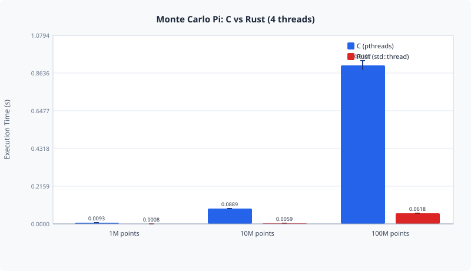
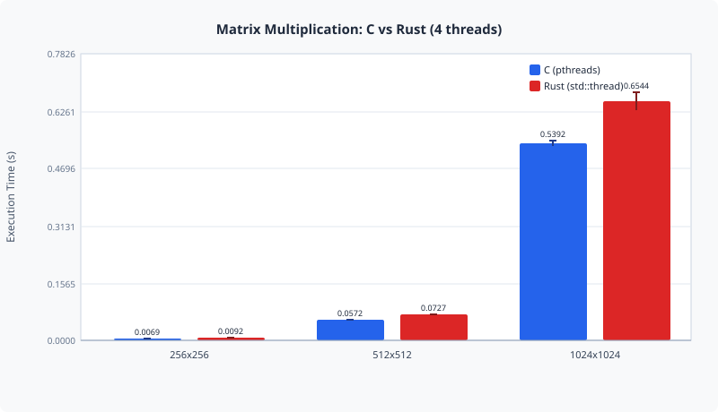
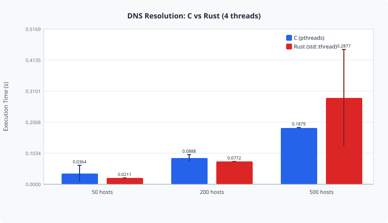

# C vs Rust: Multithreaded Performance

**CSCI 440 – Operating Systems · CSU Chico · Spring 2026**
Erik Flores-Siemsen

This repo collects my operating systems coursework. The centerpiece is the **final project**, a head-to-head benchmark of C (`pthreads`) and Rust (`std::thread`) on three parallel workloads that each stress a different part of the system. The rest of the repo holds the semester's assignments: a shell, a CPU scheduler, a pager, and two DNS resolvers.

---

## Final Project: Does C or Rust Thread Better?

The question: across workloads with very different bottlenecks, does C or Rust come out ahead when you write the same multithreaded program in both?

| Workload | Bound by | What it does | Sizes tested |
|---|---|---|---|
| **Monte Carlo π** | CPU | Random points in a unit square; the fraction inside the quarter circle estimates π/4 | 1M, 10M, 100M points |
| **Matrix multiply** | Memory | Dense `N×N` double-precision multiply, rows split across threads | 256, 512, 1024 |
| **DNS resolution** | I/O | Requester/resolver threads around a bounded buffer, resolving real hostnames | 50, 200, 500 hosts |

Every configuration ran **50 trials at 4 threads**. Reported times are means with a 95% margin of error.

### Results

Mean wall-clock time in seconds, from [`results/summary.csv`](final_project/results/summary.csv):

| Workload | Size | C | Rust | Faster |
|---|---|---:|---:|---|
| Monte Carlo | 1M | 0.0093 | 0.0008 | Rust, ~12× |
| Monte Carlo | 10M | 0.0889 | 0.0059 | Rust, ~15× |
| Monte Carlo | 100M | 0.9107 | 0.0618 | Rust, ~15× |
| Matrix | 256 | 0.0069 | 0.0092 | C, ~25% |
| Matrix | 512 | 0.0572 | 0.0727 | C, ~21% |
| Matrix | 1024 | 0.5392 | 0.6544 | C, ~18% |
| DNS | 50 | 0.0364 | 0.0211 | ~tie |
| DNS | 200 | 0.0888 | 0.0772 | ~tie |
| DNS | 500 | 0.1879 | 0.2877 | ~tie |

Graphs are in [`results/graphs/`](final_project/results/graphs/):

<p align="center">
  
  
  
</p>

### What the numbers actually say

- **Monte Carlo: the RNG decides the result, not the language.** The C version calls `rand()`, which shares hidden global state across threads, so the four threads end up fighting over it. The Rust version gives each thread its own linear congruential generator. The ~15× gap measures that design difference. Swapping C to a per-thread generator such as `rand_r()` or a hand-rolled LCG should close most of it.
- **Matrix multiply: C wins by roughly 20%.** Both versions use the same naive triple loop, split by rows. Rust's borrow checker won't let threads write into one shared output buffer, so each thread fills its own chunk and the results are copied back afterward. Bounds checks on indexing add more cost on top. Iterator-based indexing or a transposed `B` would likely narrow the gap.
- **DNS: effectively a tie.** Runtime is dominated by network round-trips, so the language barely matters. The large margins on C/50 and Rust/500 come from a few multi-second outlier lookups, not from a consistent difference. The minimum times are nearly identical across the board.

The full write-up is in [`paper/`](final_project/paper/).

### Layout

```
final_project/
├── montecarlo/{c,rust}/   CPU-bound benchmark
├── matrix/{c,rust}/       memory-bound benchmark
├── dns/{c,rust}/          I/O-bound benchmark (bounded-buffer producer/consumer)
├── scripts/
│   ├── run_all_tests.sh   runs all 18 configs × 50 trials → results/raw_data/ (build first)
│   └── analyze.c          mean / std dev / 95% margin-of-error helpers
├── results/
│   ├── raw_data/          per-trial CSVs
│   ├── summary.csv        aggregated stats
│   └── graphs/            SVG charts
├── paper/                 final report (PDF)
└── references/            sources
```

### Build and run

Requirements: `gcc` with pthreads, plus a Rust toolchain (`cargo`). Linux or macOS. DNS needs a network connection.

```bash
cd final_project

# C
make -C montecarlo/c
make -C matrix/c
make -C dns/c

# Rust
(cd montecarlo/rust && cargo build --release)
(cd matrix/rust     && cargo build --release)
(cd dns/rust        && cargo build --release)

# Run a single benchmark
./montecarlo/c/montecarlo 10000000 4
./matrix/rust/target/release/matrix 512 4
./dns/c/dns 200 4 results.txt

# Or reproduce everything (50 trials each, 4 threads)
./scripts/run_all_tests.sh
```

Each program prints `Elapsed time: <seconds>`, which the runner script parses into CSV.

---

## Coursework

The assignment handouts are from CSU Chico's CSCI 440 course, adapted from CU Boulder's CSCI 3753. My implementations live inside each handout folder.

| Folder | Assignment | Language | Topics |
|---|---|---|---|
| [`shell/`](shell/) | Unix shell with job control (`tsh`) | C | `fork`/`exec`, signals, foreground/background jobs |
| [`scheduler/`](scheduler/) | CPU scheduler simulator | Rust | simple, round robin, multilevel round robin, multilevel feedback |
| [`paging/`](paging/) | Virtual memory pager | C | basic, LRU, and predictive page replacement |
| [`dns/`](dns/) | Multithreaded DNS resolver | C + Rust | pthreads, bounded buffer, mutexes and condition variables |
| [`dns2/`](dns2/) | Multi-process DNS resolver | C | IPC, shared memory, process-shared mutexes |
| [`labs/`](labs/) | Weekly Rust labs | Rust | Ownership, borrowing, concurrency basics |

---

## References

See [`final_project/references/references.md`](final_project/references/references.md).